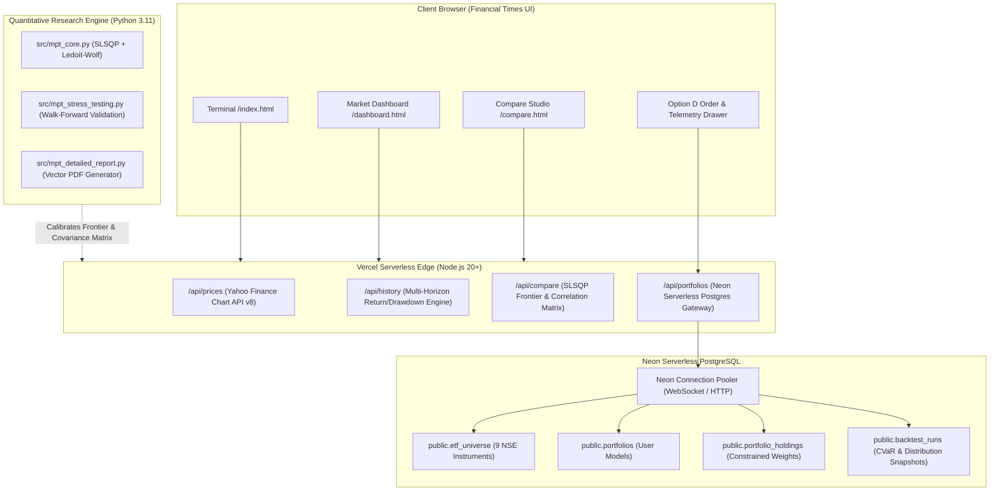

# 📰 ETF Optima — Institutional Indian ETF Portfolio Optimizer (v4.0)

[](https://web-six-zeta-72.vercel.app)
[](https://neon.tech)
[](https://python.org)
[](https://nodejs.org)
[](tests/)
[](LICENSE)

**Live Production Terminal:** [https://web-six-zeta-72.vercel.app](https://web-six-zeta-72.vercel.app)  
*(Real-time NSE ETF prices · Financial Times Editorial Interface · Option D Execution Depth · Neon Serverless Postgres)*

---

## 🏛️ Executive Summary

**ETF Optima** is an institutional-grade quantitative Robo-Advisor designed for the Indian ETF ecosystem (NSE). Prepared under the analytical framework of the **NISM Research Analyst (RA Series 15)** certification, the system bridges Modern Portfolio Theory (MPT) with real-world exchange execution constraints.

Unlike generic robo-advisors that output theoretical fractional percentages or generic "AI-slop" card decks, ETF Optima combines:
1. **Financial Times Editorial Design System:** Bespoke newsprint aesthetic (`#FFF1E5`), Oxford Navy typography (`#0C2340`), Claret drawdown accents (`#990F3D`), and monospaced tabular numerals (`JetBrains Mono`).
2. **Option D Execution Depth:** Instant integer whole-share calculation ($\lfloor \text{Allocation} / \text{LTP} \rfloor$), rupee cash remainders, allocation drift tracking, and single-click broker order slips.
3. **Institutional Quantitative Telemetry:** Ledoit-Wolf analytical covariance shrinkage, SLSQP quadratic optimization, CVaR 95% tail-risk, Sortino, Calmar, and historical stress testing (COVID-19 2020 crash, 2022 Fed rate tightening).
4. **Neon Serverless PostgreSQL:** Multi-tenant relational schema with Row-Level Security (RLS), connection pooling via `@neondatabase/serverless` over stateless HTTP pipelining, and sub-10ms query execution.

---

## 🏗️ End-to-End System Architecture



---

## 🎯 Option D: Institutional Execution Depth

Theoretical portfolio percentages often fail in practical execution due to odd-lot integer lot sizing. ETF Optima solves this by introducing **Option D Execution Math**:

$$\text{Shares}_i = \left\lfloor \frac{W_i \times \text{Capital}}{\text{LTP}_i} \right\rfloor$$

$$\text{Effective Capital Invested} = \sum_{i=1}^N \left( \text{Shares}_i \times \text{LTP}_i \right)$$

$$\text{Unallocated Cash Buffer} = \text{Capital} - \text{Effective Capital Invested}$$

$$\text{Execution Drift}_i = \left| \frac{\text{Shares}_i \times \text{LTP}_i}{\text{Effective Capital Invested}} - W_i \right|$$

* **Zero Fractional Shares:** Automatically computes exact whole-unit order counts for Zerodha, Groww, AngelOne, or Dhan.
* **Cash Remainder Ledger:** Tracks exact residual cash down to ₹0.01.
* **Tracking Drift Warning:** Alerts the investor if odd-lot rounding introduces $>0.50\%$ tracking error relative to the optimal Sharpe weights.
* **One-Click Broker Order Slip:** Formatted basket text ready for immediate clipboard paste into order pads.

---

## 🔬 Mathematical Formulation

### 1. Max Sharpe Portfolio (Tangency Portfolio)
Maximizes excess expected return per unit of total portfolio risk:

$$\max_{\mathbf{w}} \quad \frac{\mathbf{w}^T \boldsymbol{\mu} - R_f}{\sqrt{\mathbf{w}^T \boldsymbol{\Sigma} \mathbf{w}}}$$

$$\text{subject to} \quad \sum_{i=1}^N w_i = 1, \quad 0 \le w_i \le 0.45 \quad \forall i$$

Where:
* $\boldsymbol{\mu}$: Annualized geometric mean return vector ($252$ trading days).
* $\boldsymbol{\Sigma}$: Ledoit-Wolf shrinkage regularized covariance matrix.
* $R_f = 6.80\%$: Current RBI 91-Day Treasury Bill benchmark yield.
* $w_i \le 0.45$: Regulatory single-asset concentration cap preventing over-leveraging into any single instrument.

### 2. Minimum Volatility Portfolio
Constructs the absolute lowest risk boundary along the Markowitz Efficient Frontier:

$$\min_{\mathbf{w}} \quad \mathbf{w}^T \boldsymbol{\Sigma} \mathbf{w} \quad \text{s.t.} \quad \sum w_i = 1, \quad 0 \le w_i \le 0.45$$

### 3. Downside Tail Risk (CVaR 95%)
Calculates the Conditional Value at Risk (Expected Shortfall) during worst-case 5% left-tail market events:

$$\text{CVaR}_\alpha(\mathbf{w}) = \mathbb{E} \left[ R_p \mid R_p \le \text{VaR}_\alpha(\mathbf{w}) \right]$$

---

## 🌐 Curated 9-ETF Universe (NSE India)

| Ticker | Asset Class | Benchmark | Role in Asset Allocation |
| :--- | :--- | :--- | :--- |
| **`NIFTYBEES.NS`** | Large-Cap Equity | Nifty 50 Index | Core domestic equity growth |
| **`JUNIORBEES.NS`** | Next 50 Equity | Nifty Next 50 Index | Mid/large-cap alpha generation |
| **`MID150BEES.NS`** | Mid-Cap Equity | Nifty Midcap 150 | High-beta compounding factor |
| **`BANKBEES.NS`** | Financial Sector | Nifty Bank Index | High-liquidity structural banking play |
| **`MON100.NS`** | US Technology | Nasdaq 100 Index | Currency hedge & global tech exposure |
| **`GOLDBEES.NS`** | Precious Metals | Domestic Gold Spot | Non-correlated inflationary hedge |
| **`SILVERBEES.NS`** | Industrial Metals | Domestic Silver Spot | High-beta commodity diversification |
| **`LTGILTBEES.NS`** | Sovereign Debt | 8-13 Yr G-Sec Index | Duration-matched risk-free ballast |
| **`LIQUIDBEES.NS`** | Cash Equivalent | Overnight Call Rate | Zero-volatility cash floor & dividend sweep |

---

## 🐘 Neon Serverless PostgreSQL Database

ETF Optima supports multi-user portfolio tracking and backtest snapshot archiving powered by **Neon Postgres**:

* **Connection Pooling:** Connects via `@neondatabase/serverless` over HTTP with zero connection setup overhead.
* **Row-Level Security (RLS):** Strictly isolates user portfolios using cryptographic UUID tokens.
* **Automated Migrations:** DDL schema in [`docs/database/schema.sql`](docs/database/schema.sql) seeds the 9-ETF catalog and establishes check constraints ($0 \le w_i \le 1$).

### Provisioning on Vercel
1. Open your Vercel Project Dashboard $\rightarrow$ **Storage** $\rightarrow$ **Connect Neon Postgres**.
2. Run the SQL script from [`docs/database/schema.sql`](docs/database/schema.sql) in the Neon Console.
3. For comprehensive setup instructions, see the [`Neon Postgres Guide`](docs/database/NEON_POSTGRES_GUIDE.md).

---

## 📁 Repository Structure

```
.
├── api/                                  # Root Vercel Edge Serverless Handlers (Pure Node.js)
│   ├── compare.js                        # SLSQP Frontier & 9x9 Heatmap API
│   ├── db.js                             # Neon Postgres HTTP Client
│   ├── history.js                        # Multi-Horizon Return & Drawdown Service
│   ├── portfolios.js                     # Portfolio CRUD & Catalog API
│   └── prices.js                         # Real-Time Yahoo Finance Ingestion
├── docs/                                 # Architectural Documentation & Schemas
│   ├── database/
│   │   ├── NEON_POSTGRES_GUIDE.md        # Neon Serverless Postgres Integration Guide
│   │   └── schema.sql                    # Production PostgreSQL DDL & Seed Script
│   └── generate_docs.py                  # HTML Documentation Generator
├── notebooks/                            # Quantitative Research Lab
│   ├── 01_exploratory_analysis.ipynb     # Initial ETF Return Distributions
│   └── v-02_interactive_analysis.ipynb   # Interactive MPT Lab
├── src/                                  # Offline Quantitative Modeling Core
│   ├── api_python/                       # Legacy Python API Archive
│   ├── mpt_core.py                       # SciPy SLSQP Solver & Ledoit-Wolf Shrinkage
│   ├── mpt_detailed_report.py            # Local Vector PDF Generator
│   ├── mpt_indian_etf_analysis.py        # Chart Generation Utility
│   └── mpt_stress_testing.py             # Historical Crash Backtester
├── tests/                                # Automated Testing Suite
│   ├── test_optimizer.py                 # 21 Pytest Optimization Unit Tests
│   └── test_schema_syntax.py             # 4 Pytest PostgreSQL DDL Tests
├── web/                                  # Vite Frontend Application
│   ├── api/                              # Local Vite API Mirror
│   ├── public/                           # Static Assets (Reports, Icons)
│   ├── compare.html                      # Financial Times Compare Studio
│   ├── dashboard.html                    # Financial Times Live Market Dashboard
│   ├── index.html                        # Financial Times Main Landing Terminal
│   ├── main.js                           # Reactive State & Option D Execution Engine
│   ├── style.css                         # Financial Times Typography & Newsprint Palette
│   └── vite.config.js                    # Multi-Page Build Configuration
├── package.json                          # Root Node Dependencies & Build Scripts
├── requirements.txt                      # Quantitative Python Requirements
└── vercel.json                           # Production Vercel Build Orchestrator
```

---

## ⚡ Quickstart & Local Development

### 1. Prerequisites
* **Node.js:** `v20.11.0` or higher
* **Python:** `v3.10` or `3.11` (for offline research core)

### 2. Frontend Development Server
```bash
# Clone the repository
git clone https://github.com/shibom-lang/MPT-Indian-ETF-Optimization.git
cd MPT-Indian-ETF-Optimization

# Install dependencies and launch Vite
npm install
cd web && npm install && npm run dev
```
Navigate to `http://localhost:5173` to explore the main terminal, `/dashboard.html`, or `/compare.html`.

### 3. Running Pytest Suite
```bash
# Set up Python environment
python3 -m venv .venv
source .venv/bin/activate
pip install -r requirements.txt pytest

# Execute all 25 unit tests
pytest tests/ -v
```

---

## 🛡️ License & Disclaimer

Distributed under the **MIT License**.

> **Disclaimer:** This software is strictly for educational, scientific, and quantitative research purposes. It does not constitute investment or financial advice. The models and outputs do not guarantee future performance. Please consult a SEBI-registered investment advisor before making financial investments.
