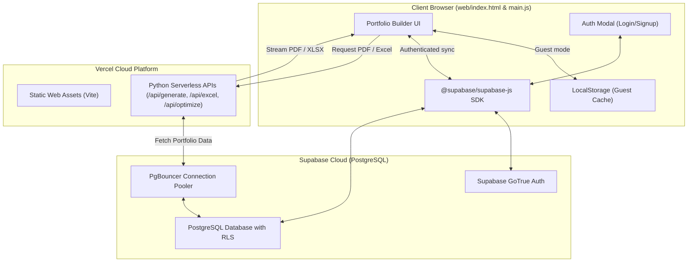

# Design Document: ETF Optima Scaling Architecture
## PostgreSQL Database, User Accounts, and Multi-ETF Analytics on Vercel

**Document Path:** `docs/superpowers/specs/2026-11-17-etf-optima-scaling-design.md`  
**Date:** 2026-11-17  
**Status:** Under Review (Builder Check)  

---

## 1. Intent and The "Why"
ETF Optima currently operates as a static, stateless 9-ETF demonstration. To scale it into a professional, multi-user quantitative robo-advisor platform, it must allow visitors, recruiters, and analysts to:
1. Create an account (or test immediately as a guest).
2. Construct custom multi-ETF portfolios from a broad universe of Indian and international ETFs.
3. Save, edit, and rebalance their custom portfolios.
4. Run live Modern Portfolio Theory (MPT) optimization and Monte Carlo stress tests.
5. Persist all portfolio configurations and analytical test runs to a cloud database across client and server.

This upgrade serves two distinct purposes:
* **Product Purpose:** Provide real utility for investors who want to test and optimize custom ETF baskets.
* **Career/Portfolio Purpose:** Demonstrate institutional-grade **Database Engineering (PostgreSQL, SQL Schemas, RLS, Constraints)** and **Data Analytics (Time-Series, Risk Metrics, Optimization)** on a resume.

---

## 2. Goals, Non-Goals, and Anti-Goals

### Goals
* **Cloud PostgreSQL Relational Schema:** Production-ready tables for users, ETFs, custom portfolios, individual holdings, and backtest run logs.
* **Mathematical Integrity via SQL Constraints:** Database-enforced constraints (e.g., weights must be $\ge 0$ and $\le 1.0$, foreign keys with cascade deletions).
* **Enterprise Security with Row-Level Security (RLS):** True multi-tenant privacy enforced directly at the database engine level.
* **Dual Persistence (Client + Server):**
  * Client-side: Real-time interactive UI updates via the Supabase JavaScript SDK.
  * Server-side: Vercel serverless Python functions securely querying user portfolios to run MPT math, generate customized Matplotlib PDFs, and build dynamic OpenPyxl Excel schedules.
* **Zero-Friction Guest Experience:** Visitors can build and test custom ETF portfolios immediately without being blocked by a mandatory signup modal.
* **1-Click Authentication:** Google OAuth and Email/Password authentication.

### Non-Goals
* **Brokerage Order Execution:** Placing real-money orders via Zerodha Kite or Groww APIs (this platform is an analytical and advisory engine).
* **Paid Subscriptions / Paywalls:** The platform is free to use and explore for demonstration and educational purposes.

### Anti-Goals
* **Mandatory Login Wall on Page Load:** Never block a recruiter or visitor with a forced login dialog before they can test the optimizer.
* **Monolithic Server Infrastructure:** Never introduce a dedicated VPS (EC2/Droplet) requiring manual operating system or database maintenance; the architecture must stay 100% cloud-native and serverless.

---

## 3. Constraints
* **Hosting Platform:** Must deploy to **Vercel** (`web-six-zeta-72.vercel.app`) using existing static asset hosting and Python serverless API functions (`/api/*.py`).
* **Serverless Execution Window:** Python serverless functions on Vercel run with a 10–15 second timeout. Database queries and MPT optimization must execute well within this limit (efficient connection pooling and caching).
* **Cost:** Must operate entirely within the permanent free tiers of Vercel and Supabase.

---

## 4. Approaches Considered & Trade-offs

| Approach | Architecture | Strengths | Trade-offs & Weaknesses | Decision |
| :--- | :--- | :--- | :--- | :--- |
| **A. In-Memory / LocalStorage Only** | Client-only state | Zero setup, fast | No cross-device saving, no real database skills demonstrated, cannot share portfolios | ❌ Rejected (Does not scale) |
| **B. NoSQL (Firebase / MongoDB)** | Document store (JSON) | Easy schema changes | No relational integrity, poor analytical query performance, weak perception in quant finance | ❌ Rejected (Fails data analytics goals) |
| **C. MySQL / MariaDB on VPS** | Self-hosted relational DB | Familiar SQL dialect | No native Row-Level Security, connection spikes crash serverless functions, costly maintenance | ❌ Rejected (Breaks serverless architecture) |
| **D. Cloud PostgreSQL (Supabase)** | Managed Postgres + Auth + RLS | Native RLS, advanced analytical functions, binary JSONB, serverless connection pooling, 1-click Auth | Requires setting environment variables in Vercel | 🏆 **Selected Approach** |

### Why PostgreSQL via Supabase Was Chosen
1. **Industry Standard:** Finance and quantitative research teams demand relational SQL.
2. **Serverless Connection Resilience:** Supabase provides built-in connection pooling (PgBouncer) and REST/HTTPS endpoints, completely eliminating the "connection exhaustion" bug on Vercel.
3. **Turnkey Auth + RLS:** Provides Google OAuth and Email authentication out of the box, with database-level security policies.

---

## 5. Architectural Blueprint ("How It Gets Built")



---

## 6. PostgreSQL Database Schema

### Table 1: `profiles`
Links directly to Supabase `auth.users`.
```sql
CREATE TABLE public.profiles (
    id UUID PRIMARY KEY REFERENCES auth.users(id) ON DELETE CASCADE,
    email TEXT NOT NULL,
    full_name TEXT,
    created_at TIMESTAMPTZ DEFAULT NOW(),
    updated_at TIMESTAMPTZ DEFAULT NOW()
);
```

### Table 2: `etf_universe`
Master catalog of available Indian & Global ETFs with asset classifications.
```sql
CREATE TABLE public.etf_universe (
    ticker TEXT PRIMARY KEY,
    name TEXT NOT NULL,
    asset_class TEXT NOT NULL, -- 'Large Cap', 'Mid Cap', 'Debt', 'Commodity', 'US Equity'
    exchange TEXT DEFAULT 'NSE',
    expense_ratio NUMERIC(4, 2),
    is_active BOOLEAN DEFAULT TRUE
);
```

### Table 3: `portfolios`
User-created portfolio models.
```sql
CREATE TABLE public.portfolios (
    id UUID PRIMARY KEY DEFAULT gen_random_uuid(),
    user_id UUID NOT NULL REFERENCES public.profiles(id) ON DELETE CASCADE,
    name TEXT NOT NULL,
    description TEXT,
    strategy TEXT DEFAULT 'custom', -- 'custom', 'max_sharpe', 'min_vol'
    investment_amount NUMERIC(12, 2) DEFAULT 100000.00,
    created_at TIMESTAMPTZ DEFAULT NOW(),
    updated_at TIMESTAMPTZ DEFAULT NOW()
);
```

### Table 4: `portfolio_holdings`
Individual ETF holdings within a portfolio. Enforces strict mathematical limits.
```sql
CREATE TABLE public.portfolio_holdings (
    id UUID PRIMARY KEY DEFAULT gen_random_uuid(),
    portfolio_id UUID NOT NULL REFERENCES public.portfolios(id) ON DELETE CASCADE,
    ticker TEXT NOT NULL REFERENCES public.etf_universe(ticker),
    weight NUMERIC(5, 4) NOT NULL, -- e.g. 0.2500 for 25%
    created_at TIMESTAMPTZ DEFAULT NOW(),
    CONSTRAINT check_weight_bounds CHECK (weight >= 0.0000 AND weight <= 1.0000),
    CONSTRAINT unique_portfolio_ticker UNIQUE (portfolio_id, ticker)
);
```

### Table 5: `backtest_runs`
Historical logs of optimization and stress test calculations.
```sql
CREATE TABLE public.backtest_runs (
    id UUID PRIMARY KEY DEFAULT gen_random_uuid(),
    portfolio_id UUID NOT NULL REFERENCES public.portfolios(id) ON DELETE CASCADE,
    expected_return NUMERIC(6, 4) NOT NULL,
    annual_volatility NUMERIC(6, 4) NOT NULL,
    sharpe_ratio NUMERIC(6, 4) NOT NULL,
    sortino_ratio NUMERIC(6, 4),
    max_drawdown NUMERIC(6, 4),
    cvar_95 NUMERIC(6, 4),
    metrics_meta JSONB, -- Stores full simulation distributions & rolling correlation
    executed_at TIMESTAMPTZ DEFAULT NOW()
);
```

### Row-Level Security (RLS) Policies
```sql
-- Enable RLS
ALTER TABLE public.profiles ENABLE ROW LEVEL SECURITY;
ALTER TABLE public.portfolios ENABLE ROW LEVEL SECURITY;
ALTER TABLE public.portfolio_holdings ENABLE ROW LEVEL SECURITY;
ALTER TABLE public.backtest_runs ENABLE ROW LEVEL SECURITY;

-- Profiles: Users can view and update their own profile
CREATE POLICY "Users can view own profile" ON public.profiles FOR SELECT USING (auth.uid() = id);
CREATE POLICY "Users can update own profile" ON public.profiles FOR UPDATE USING (auth.uid() = id);

-- Portfolios: Users can CRUD only their own portfolios
CREATE POLICY "Users can view own portfolios" ON public.portfolios FOR SELECT USING (auth.uid() = user_id);
CREATE POLICY "Users can insert own portfolios" ON public.portfolios FOR INSERT WITH CHECK (auth.uid() = user_id);
CREATE POLICY "Users can update own portfolios" ON public.portfolios FOR UPDATE USING (auth.uid() = user_id);
CREATE POLICY "Users can delete own portfolios" ON public.portfolios FOR DELETE USING (auth.uid() = user_id);

-- Holdings: Inherit access via parent portfolio ownership
CREATE POLICY "Users can view own holdings" ON public.portfolio_holdings FOR SELECT
    USING (EXISTS (SELECT 1 FROM public.portfolios WHERE portfolios.id = portfolio_holdings.portfolio_id AND portfolios.user_id = auth.uid()));
CREATE POLICY "Users can modify own holdings" ON public.portfolio_holdings FOR ALL
    USING (EXISTS (SELECT 1 FROM public.portfolios WHERE portfolios.id = portfolio_holdings.portfolio_id AND portfolios.user_id = auth.uid()));
```

-- Backtest Runs: Users can view and insert backtest runs for their own portfolios
CREATE POLICY "Users can view own backtest runs" ON public.backtest_runs FOR SELECT
    USING (EXISTS (SELECT 1 FROM public.portfolios WHERE portfolios.id = backtest_runs.portfolio_id AND portfolios.user_id = auth.uid()));
CREATE POLICY "Users can insert own backtest runs" ON public.backtest_runs FOR INSERT
    WITH CHECK (EXISTS (SELECT 1 FROM public.portfolios WHERE portfolios.id = backtest_runs.portfolio_id AND portfolios.user_id = auth.uid()));

---

## 7. Refined Builder Architectural Contracts (Post-Review Decisions)

Based on the builder check review, the following core technical contracts are finalized:

### A. Stateless Serverless API Contract (Dual-Mode for Guest & Auth)
* To prevent connection exhaustion, JWT overhead, and 504 timeouts on Vercel, the Python serverless endpoints (`/api/optimize`, `/api/generate`, `/api/excel`) will remain **stateless**.
* The client passes the full portfolio payload directly in the request (e.g. `POST /api/optimize` with `{ tickers: [...], target_weights: {...}, amount: 100000 }`).
* **Why this is superior:** The exact same Python serverless code handles both unauthenticated Guests (from `localStorage`) and Authenticated users (from Supabase). Supabase handles storage and RLS; Python handles math.

### B. Pre-Seeded Indian ETF Universe & Currency Isolation
* All ETFs in `etf_universe` are strictly NSE-listed instruments denominated in **INR** (e.g., `MON100.NS` for Nasdaq 100, `GOLDBEES.NS` for Gold, `NIFTYBEES.NS` for Nifty 50). This eliminates cross-currency FX conversion errors.
* Dynamic price caching is implemented with an in-memory/disk 24-hour cache layer to keep response times under 2 seconds and strictly prevent Vercel 10s timeouts.

### C. Live MPT Optimization Engine Location
* The mathematical optimization (SLSQP solver, covariance matrix, efficient frontier) runs in **Python serverless** via a dedicated endpoint `POST /api/optimize`, reusing `src/mpt_core.py`.
* Results (optimal weights, Sharpe, volatility) are returned as JSON for instant client rendering.

---

## 8. User Experience & Application Workflow

1. **Unauthenticated Visitor (Guest Experience):**
   * Visitor lands on `web-six-zeta-72.vercel.app`.
   * Can browse the ETF catalog, select 3 to 10 ETFs, and tweak target weights.
   * Clicks **"Run Optimization / Backtest"**: Math executes immediately in the browser or via public API.
   * Unauthenticated state is saved temporarily in browser `localStorage`.
2. **Account Creation & Login:**
   * Visitor clicks **"Save Portfolio"** or **"Sign In"** in the top navigation.
   * Clean glassmorphism modal opens with:
     * *Continue with Google* (1-click OAuth)
     * *Continue with Email & Password*
   * Upon successful authentication, any local guest portfolio automatically migrates to their Supabase PostgreSQL account.
3. **Authenticated Dashboard ("My Portfolios"):**
   * Shows a list of the user's saved portfolios.
   * Users can click any portfolio to view its live performance, compare it against Nifty 50, download a custom institutional PDF, or export an OpenPyxl financial model.

---

## 8. What's Left to the Builder (Implementation Tasks)
* **Frontend Components:**
  * Add the Auth Modal (HTML/CSS) to `web/index.html` and `web/dashboard.html`.
  * Implement the Supabase JS client integration in `web/main.js` (including login, signup, logout, and auth state listeners).
  * Build the multi-ETF selector (allowing users to search and add tickers from `etf_universe`).
* **Backend Endpoints:**
  * Update `/api/generate.py` and `/api/excel.py` to optionally accept a `portfolio_id` or custom dynamic ticker list with weights, rather than relying solely on the hardcoded 9-ETF enum.
* **Environment Configuration:**
  * Set `VITE_SUPABASE_URL` and `VITE_SUPABASE_ANON_KEY` in Vercel project environment variables.
  * Supply database migration scripts under `docs/database/schema.sql`.
